# Upload performance and recovery

The invitation and uploader remain separate deployments. Guests use the same controls and private Drive destination. Originals are not recompressed. The photo limit stays 25 MiB and the video limit stays 1 GiB.

## Current flow

```mermaid
flowchart LR
  A[Choose files and validate] --> B[Hash and save recovery identity]
  B --> C[Four bounded file lifecycles]
  C --> D[Two control requests maximum]
  D --> E[Authorize and resolve private destination]
  E --> F[Two byte transfers maximum]
  F --> G[Ordered adaptive chunks to Drive]
  G --> H[Verify stored size, type, checksum and parent]
  H --> I[Show completed receipt and release device copy]
```

Four file lifecycles allow upcoming authorization and completed-file confirmation to overlap byte transfers. They do not start four simultaneous video bodies. Control requests are capped at two, and confirmations have priority over queued preparation. The legacy relay remains serialized. The browser-tab lock covers the complete batch until every worker settles.

Each Drive resumable session sends one byte range at a time. The next range follows Drive's confirmed offset. Independent files can transfer concurrently; out-of-order parts of one file are not an upload mode offered by this integration. Switching to temporary part storage and server-side assembly would introduce another backend and an additional transfer into Drive.

## Large-video request sizes

New sessions advertise an 8 MiB initial chunk and a 32 MiB ceiling. The client measures each non-final transfer, aims for roughly 12 seconds of data, doubles at most, and rounds to Drive's 256 KiB boundaries. Slow connections reduce the chunk size; retries also reduce it after reconciling accepted bytes. The last chunk can be shorter. Older service responses without the new ceiling retain their original 8 MiB behavior.

For an ideal fast transfer, a 1 GiB file can use 34 data requests instead of 128. This is a request-count calculation, not a duration guarantee. Two transfers still share the connection's available upload bandwidth. Google ingestion/finalization and connection conditions remain outside the website's control.

## Setup and confirmation

Known event/guest folder IDs avoid repeated folder searches. They are location hints, not authorization: the owner service rechecks current ownership, Restricted sharing and parent relationships every time. First-time folder creation preserves checks before writing into each parent.

Independent root/event/guest permission checks and final-file metadata reads use one `UrlFetchApp.fetchAll` batch. This reduces sequential waiting while retaining each individual check. File-byte requests are not included in that batch.

Drive file IDs are pre-generated in groups of 25. The existing script lock protects a durable `PHOTO_FILE_ID_POOL` property; an ID is removed before being assigned to a job. A retry keeps its saved ID. A failed reservation aborts admission. A best-effort cache is not used for unique-ID allocation. Event-location properties are also internal state and need no manual setup.

Settings, the spreadsheet handle and the OAuth token are reused only within one execution. Account tokens, private destination IDs and other guests' sessions never reach the guest. A guest receives only the current file's scoped upload session. These session URLs are not saved in browser recovery records or explicitly logged by application code.

## Background and recovery behavior

A merely hidden tab no longer intentionally pauses the batch. Bytes can continue while the browser keeps the document alive. The screen-awake lock is released when hidden and reacquired when appropriate on return.

Actual `freeze` or `pagehide` events pause new work, and `resume`, `pageshow` or returning visibility can resume a previously automatic pause. Offline recovery remains automatic. A manual pause remains manual across lifecycle events. Closing the browser, locking a phone or OS suspension can still stop browser execution; this is best-effort website behavior, not a guaranteed background service.

An explicit Upload action also records the authorized pending IDs in the existing browser queue database. A newly loaded page can automatically continue those cached photos if the record is less than seven days old and the browser supports Web Locks. Newly selected files and completed IDs are excluded. Manual pause writes a synchronous cancellation marker and removes the automatic intent; a later explicit Upload or Continue authorizes it again. The record contains no photo bytes, filenames, guest names, account tokens or upload-session URLs. Recovery writes settle before a batch becomes idle, and automatic restarts occur only after the previous Web Lock is released.

The browser saves confirmed offsets after acknowledgements. Recovery checks Drive before resending an ambiguous chunk, and completion is accepted only after the owner verifies the stored file. A failure stops new work while retaining other verified files. UI progress for another active file does not rewind when a completed row redraws.

## Measurements and verification

A live test of the previous deployed version uploaded one synthetic 9 MiB JPEG in approximately 29 seconds. Its opening Apps Script call took 13.0 seconds, the 8 MiB data request 4.0 seconds, the final 1 MiB request 8.4 seconds, and confirmation 3.6 seconds. Direct upload was offered and used; no relay chunks were sent. This single observation includes real Google and network variability and is not an isolated bandwidth benchmark. The test image is labelled `upload-speed-diagnostic.jpg` in the private `Upload diagnostics` guest folder.

The owner's speed test reported 42.79 Mbps upstream. That is roughly 5.35 decimal MB/s, giving approximately 24 seconds of raw transfer time for 127 decimal MB before overhead. Ookla's route and Google's actual ingestion rate can differ; inactive-tab pauses also affected the previous implementation.

Automated checks cover original-file integrity, private destinations, parent changes, authorization, quota admission, ID reservation, larger chunks, transient errors, lost acknowledgements, expired sessions, relay fallback, batching, cross-file progress, tab locks, hidden tabs, actual suspension and manual pause. Local fake storage timings demonstrate reduced application overhead; they do not predict live Google upload times. The latest private browser report is `.preview/upload-speed-checks.json` and contains no real upload capabilities or account tokens.

## Deployment

Generate the combined file with `node .local/google-photos/prepare.mjs`. Replace Code.gs in the existing photo project, then deploy a new version of the same deployment. Keep the manifest, scopes, URL, Drive folder and ledger unchanged. The wishes deployment is separate. Existing open pages retain their loaded client behavior; reopen the uploader after updating.

See [photo setup and checks](google-photos-setup.md). Private service source and generated deployment files remain ignored by Git and excluded from the public website build.

Primary references: [Drive resumable uploads](https://developers.google.com/workspace/drive/api/guides/manage-uploads), [pre-generated IDs](https://developers.google.com/workspace/drive/api/guides/create-file#generate-ids), [parallel URL reads](https://developers.google.com/apps-script/reference/url-fetch/url-fetch-app#fetchAll(Object)), and [Apps Script performance guidance](https://developers.google.com/apps-script/guides/support/best-practices).
